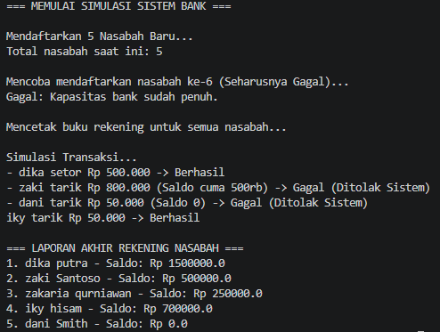

# Praktikum OOP - Sistem Perbankan Sederhana 🏦

Proyek ini adalah implementasi sistem perbankan sederhana berbasis Pemrograman Berorientasi Objek (OOP) menggunakan Java. Program ini dirancang untuk mendemonstrasikan relasi antar kelas (*Composition* dan *Aggregation*), penggunaan *Array* objek statis, serta enkapsulasi logika bisnis.

## 👨‍💻 Identitas Mahasiswa
- **Nama:** I Made Priyandika Adiyatma Putra Sari
- **NIM:** F1D2410008

## 📝 Deskripsi Singkat Program
Sistem ini mensimulasikan operasional dasar sebuah bank dengan batasan kapasitas maksimal 5 nasabah. Program ini terdiri dari beberapa entitas utama yang saling terhubung:
1. **`Account`**: Mengelola saldo (*balance*), serta memvalidasi transaksi penyetoran (*deposit*) dan penarikan (*withdraw*) agar saldo tidak menjadi minus.
2. **`Customer`**: Menyimpan data pribadi nasabah (nama depan & nama belakang) dan menghubungkannya dengan objek `Account` milik nasabah tersebut.
3. **`Bank`**: Mengelola daftar nasabah menggunakan *Array* dan membatasi pendaftaran jika kapasitas sistem sudah penuh.
4. **`Main` / `App`**: Kelas eksekusi yang menjalankan simulasi pembuatan nasabah, pemberian saldo awal, transaksi berantai, hingga pencetakan laporan akhir seluruh nasabah bank.

## 📸 Dokumentasi Program

Berikut adalah hasil dokumentasi eksekusi program

---